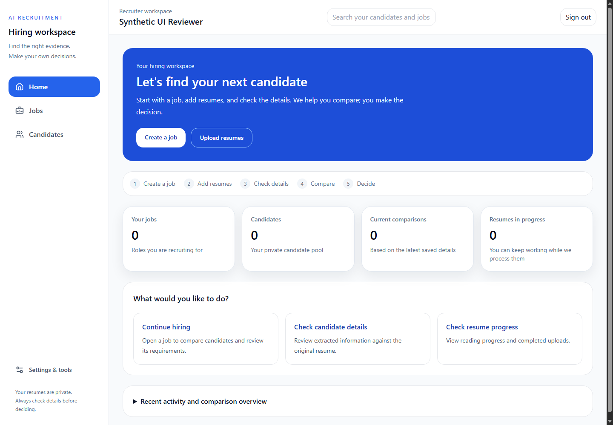
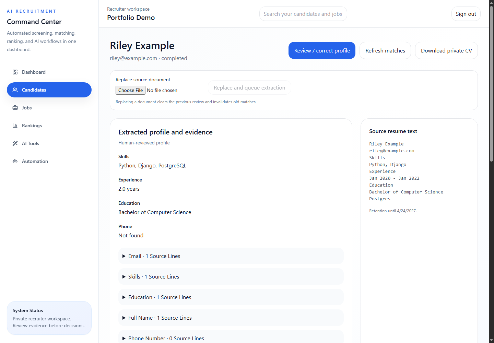
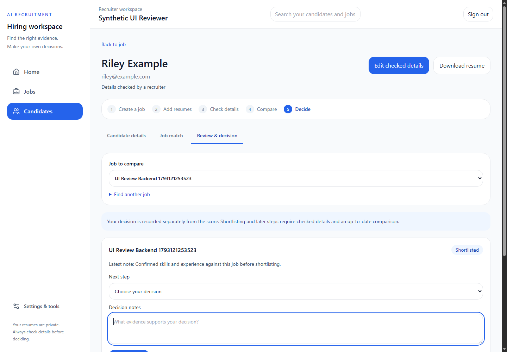
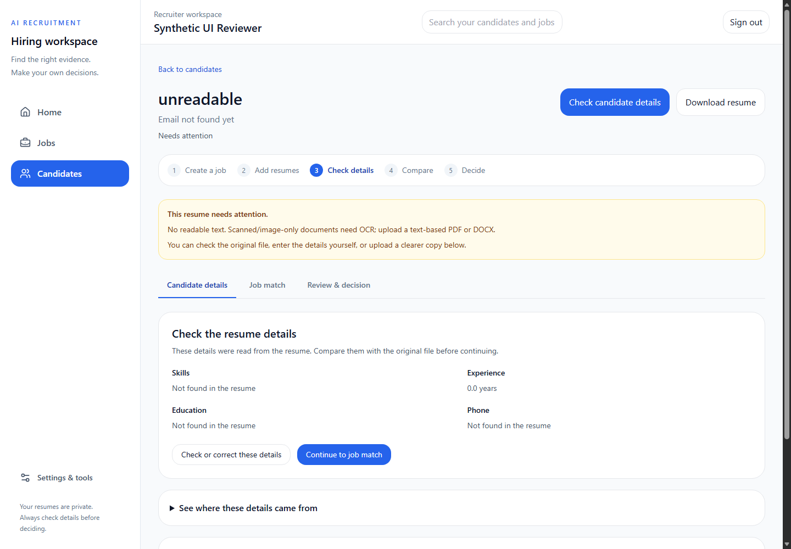

# AI Recruitment Screening System

A Django REST Framework + Next.js recruiter workspace for private CV processing, evidence review, job-specific matching, human hiring decisions, accuracy evaluation and reproducible scoring.

**Scores support human review; they are not hiring probabilities.** External AI is optional and disabled by default in a fresh installation.

The current implementation is on [improvement/portfolio-hardening](https://github.com/NomanWahdat/ai_recruitment_system/tree/improvement/portfolio-hardening). Start with the [recruiter guide](docs/RECRUITER_GUIDE.md) for the interface, or follow the setup below to run it locally.

## Hiring workflow

**Create a job -> Add resumes -> Check details -> Compare candidates -> Record a decision**

1. Create the role and its requirements. Optionally use skill suggestions, then confirm what the role needs.
2. Upload one to ten PDF/DOCX resumes. Reading happens in the background, with clear progress and per-file errors.
3. Check extracted information against the original resume and correct anything inaccurate.
4. Compare candidates with the selected job, inspect matching/missing skills, and request explanations or interview questions.
5. Record review notes and application stages. Human checks and current comparisons are required before shortlisting and later steps.

Recruiters see only their own records. CVs use authorized download endpoints. Legacy unowned records are quarantined rather than assigned automatically.

## Recruiter interface

The main navigation is **Home, Jobs and Candidates**. Start from a job, add resumes, check the extracted details, compare candidates and record your decision. Job requirements and matches share one workspace. Candidate details, job comparison, and review/decision each have their own view.

All advanced functionality remains available through **Settings & tools** and expandable details: standalone AI tools, provider diagnostics, processing/retry controls, cross-job rankings, accuracy evaluation, custom weights, source evidence, scoring components, verification, history and technical exports.

System testing now offers a **readable HTML summary** as its main download. It opens in a browser and can be printed/saved as a PDF. The full JSON download and benchmark metrics are retained under Technical benchmark data and metrics. This software test report is separate from reviewing an actual candidate.

| Where | What you can do |
|---|---|
| Home | Start a job, upload resumes, or continue work needing attention |
| Jobs | Manage requirements and candidate matches together |
| Candidates | Check profiles, compare against a job, and record decisions |
| Settings & tools | Open processing activity, standalone AI tools, cross-job comparisons and system testing |
| Expandable details | Inspect evidence, custom priorities, source/model diagnostics, score verification/history and technical exports |

No existing functionality was removed. See the [recruiter walkthrough and complete feature map](docs/RECRUITER_GUIDE.md).

## Local setup

Requires Python 3.12, PostgreSQL, and Node 22.13+ or Node 24. Use consistent frontend/API hostnames for cookie authentication.

Windows PowerShell, fresh installation:

~~~powershell
git clone --branch improvement/portfolio-hardening https://github.com/NomanWahdat/ai_recruitment_system.git
cd ai_recruitment_system
python -m venv .venv
.\.venv\Scripts\python.exe -m pip install -r requirements-dev.txt -c requirements.lock.txt
Copy-Item .env.example .env
~~~

Edit PostgreSQL credentials and create the configured database if necessary. Generate a secret with `python -c "import secrets; print(secrets.token_urlsafe(64))"` and put it in .env. Preserve an existing environment file.

~~~powershell
.\.venv\Scripts\python.exe manage.py migrate
.\.venv\Scripts\python.exe manage.py seed_demo
npm.cmd --prefix frontend ci --ignore-scripts --no-audit --no-fund
npm.cmd --prefix frontend run build
~~~

Run the following in **three separate terminals**, from the project root.

Terminal 1: API

~~~powershell
.\.venv\Scripts\python.exe manage.py runserver 127.0.0.1:8000 --noreload
~~~

Terminal 2: resume-processing worker

~~~powershell
.\.venv\Scripts\python.exe manage.py process_tasks
~~~

Terminal 3: frontend

~~~powershell
npm.cmd --prefix frontend run start -- --hostname 127.0.0.1
~~~

Open **http://127.0.0.1:3000**.

Development demo credentials: **portfolio_demo / PortfolioDemo!2026**. The seed command creates synthetic jobs, real DOCX resumes and an intentionally unreadable PDF. It preserves existing credentials unless `--reset-password` is supplied and rejects production settings. Never publish this account on a public deployment.

On Linux/macOS use the virtual environment's bin/python and npm. The optional English spaCy model is not downloaded implicitly; dictionary/regex extraction works without it.

## Configuration

See [.env.example](.env.example), [AI setup and local fallback](docs/AI_CONFIGURATION.md), and [deployment](docs/DEPLOYMENT.md).

| Variable | Purpose |
|---|---|
| SECRET_KEY | Random secret; production requires at least 50 characters |
| DB_NAME/USER/PASSWORD/HOST/PORT | Development PostgreSQL |
| DATABASE_URL | Production PostgreSQL |
| CORS_ALLOWED_ORIGINS / CSRF_TRUSTED_ORIGINS | Explicit browser origins |
| TOKEN_TTL_SECONDS | Session/API-token lifetime; default 8 hours |
| CV_RETENTION_DAYS | Default retention; 180 days |
| SKILL/EXPERIENCE/EDUCATION_WEIGHT | Defaults 0.5 / 0.3 / 0.2 |
| USE_GROQ_AI / USE_GEMINI_FALLBACK | Provider opt-in; credentials required |
| GROQ_MODEL / GEMINI_MODEL | Configure identifiers available to your provider account |
| USE_LLM_FOR_SCORING | Separate opt-in for hybrid scoring |
| AI_REQUEST_TIMEOUT | Per-provider timeout, default 30 seconds |
| NEXT_PUBLIC_API_BASE_URL | Frontend API URL, fixed at build time when configured |

Resolved Python dependency constraints are in requirements.lock.txt. No keys or real resumes belong in Git. Rebuild the frontend after changing its public API URL.

## Verified behavior

The latest local verification passed **112 PostgreSQL tests**, with **86.45% backend statement coverage**, Ruff checks, frontend ESLint with zero warnings, TypeScript, and a production build. The full browser journey passed with zero JavaScript exceptions, using an isolated synthetic account that was removed after testing.

The browser checks cover job editing/priorities, resume uploads and failures, duplicate-file feedback, evidence correction, contextual and standalone AI tools, decisions/history, score verification and exports, readable/technical evaluation downloads, and mobile navigation. See [verification details](docs/VERIFICATION.md) and the [browser report](docs/verification-browser.json). These checks establish behavior, not independent hiring accuracy. Remote CI results and container runtime must be checked separately.

## Checks

~~~powershell
.\.venv\Scripts\python.exe manage.py test --settings=config.settings.test
$env:TEST_POSTGRES='true'
.\.venv\Scripts\python.exe -m coverage run manage.py test --settings=config.settings.test --noinput
.\.venv\Scripts\python.exe -m coverage report
.\.venv\Scripts\python.exe manage.py makemigrations --check --dry-run
npm.cmd --prefix frontend run lint
npm.cmd --prefix frontend run typecheck
npm.cmd --prefix frontend run build
.\.venv\Scripts\python.exe tools/evaluate.py --check
.\.venv\Scripts\python.exe tools/create_demo_files.py
node tools/browser_e2e.cjs
~~~

The browser test requires installed Edge/Chrome; BROWSER_BIN overrides discovery. It uses an isolated synthetic recruiter account, drives real forms/uploads and saves a verification report and screenshots. It follows configured provider settings, so an AI-enabled local server can make synthetic provider calls; CI uses offline settings. Resume/job fixtures are cleaned up automatically; an empty test account can be removed through administrative tooling.

## Accuracy evaluation

Open **Settings & tools -> System testing**. This feature compares extracted fields and ranked candidates against labelled examples, shows per-split metrics and actual failure cases, and lets you download the report.

The bundled benchmark has **24 synthetic examples**: 12 regression checks and 12 harder challenge cases. Measured skill F1 is **85.71% overall**, **100% on regressions**, and **69.77% on challenges**; experience MAE is **0.27 years overall**. These values describe this small developer-authored corpus, not independent hiring accuracy. The challenge report exposes false positives from negated skills and quoted requirements.

```powershell
# Offline: no AI calls, cost, or database writes, even when a key is configured.
.\.venv\Scripts\python.exe tools/evaluate.py --check
# Evaluate your own consented/de-identified, independently labelled test data.
.\.venv\Scripts\python.exe tools/evaluate.py --dataset .runtime/labels.json --split test --output .runtime/test-results.json
```

The report includes email exact match, skill precision/recall/F1, experience error, ranking NDCG/Recall/MRR, simple baselines, bootstrap intervals, fingerprints, split leakage checks and optional two-rater agreement. A fixed reference date makes ongoing-experience examples repeatable. Custom reports stay local and cannot replace the public benchmark. Independent data and labels must be obtained separately.

An explicit `--live-ai` option compares hybrid AI ranking and records real provider outputs; it can incur provider charges. Custom data additionally requires `--allow-external-data`. It is never enabled by the default command. See [dataset schema, commands, metrics and limits](docs/EVALUATION.md).

## Reproducible scoring

Open a candidate, select a job and run matching. The **How this score was calculated** section saves the inputs and revisions, local score, actual AI score, requested/applied weights, component ratios, provider/model, versions, timestamp and fingerprint. Each rematch adds an owned history entry.

Select **Verify saved score** to replay the calculation with **zero AI calls**, **Show previous comparisons** to inspect older runs, or **Download technical score data (JSON)** to export it. For example, local 75 with AI 80 and AI weight 25% gives `75 * 0.75 + 80 * 0.25 = 76.25`. Provider failure makes the applied AI weight zero. A valid AI score of zero remains valid.

Saved arithmetic remains reproducible after profile/job/settings changes. This does not guarantee an identical future AI generation or that the evidence is correct. Fingerprints detect accidental changes; they are not digital signatures. Names, contact fields and raw CV text are excluded from snapshots. History follows candidate/job deletion and retention.

Run migrations after updating: `.\.venv\Scripts\python.exe manage.py migrate`. Older analyses have no fabricated snapshots; rematch them to create one. See [snapshot format, API, history and guarantees](docs/SCORING.md).

## Evidence package

- [Architecture and ER diagrams](docs/ARCHITECTURE.md)
- [API contracts and errors](docs/API.md)
- [Design decisions](docs/DECISIONS.md)
- [Evaluation dataset/results](docs/EVALUATION.md)
- [Reproducible scoring and history](docs/SCORING.md)
- [Demonstration and graceful failure](docs/DEMO.md)
- [Security/privacy model](docs/SECURITY.md)
- [Deployment](docs/DEPLOYMENT.md)
- [Verification evidence](docs/VERIFICATION.md)
- [Research directions](docs/RESEARCH.md)

## Screenshots

Real browser captures using synthetic data. Screenshots demonstrate the interface, not extraction accuracy or AI quality.

| Workspace | Evidence review |
|---|---|
|  |  |

| Human decision | Processing failure |
|---|---|
|  |  |

[Settings & tools](docs/screenshots/16-settings-tools.png) / [readable summary](docs/screenshots/17-readable-evaluation-summary.png) / [candidate workspace](docs/screenshots/18-candidate-match.png).

[Evaluation details](docs/screenshots/13-accuracy-evaluation.png) / [reproducible score details](docs/screenshots/14-reproducible-scoring.png).

[All captures](docs/screenshots/) and [browser report](docs/verification-browser.json). [Verified live Groq screenshot](docs/screenshots/12-groq-ai-verified.png) and [API evidence](docs/verification-ai-live.json) use synthetic data; provider connectivity is verified separately from output accuracy.

## Limits

No OCR, malware scanner, independent recruiter-labelled dataset, live-provider quality measurement or demographic-fairness certification is claimed. Local CV storage needs a shared private persistent volume. Tasks provide at-least-once delivery and idempotent database effects, not exactly-once external calls. PostgreSQL is required for concurrent workers.

Recruiter ownership is implemented; applicant accounts and organization/team delegation are not. CI/container definitions are included, but remote execution/hosting must be verified separately.

Built by [Noman Wahdat](https://github.com/NomanWahdat). This artifact demonstrates engineering and research potential; scholarship eligibility and admission remain university-specific.
