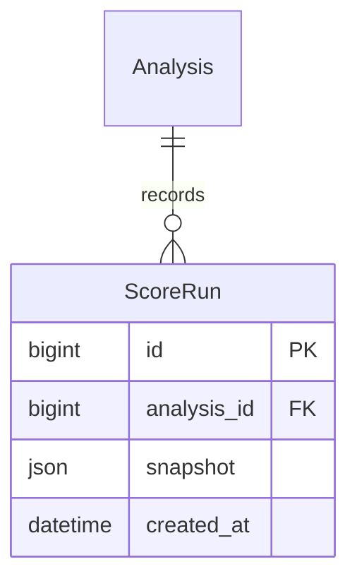

# Architecture and ER diagrams

Django REST Framework and Next.js remain. A persistent PostgreSQL task table and separate worker replace the synchronous event bus/duplicate thread path.

~~~mermaid
flowchart LR
 B[Next.js browser] -->|HttpOnly session + CSRF| A[Django REST API]
 A -->|Owner-scoped queries| P[(PostgreSQL)]
 A -->|Validated upload| F[Private CV volume]
 A -->|Atomic enqueue| Q[(ProcessingTask)]
 W[Separate worker] -->|Lease + row locks| Q
 W --> F
 W --> E[Extraction + profile evidence]
 E --> P
 W --> M[Matching + rankings]
 M --> P
 M -->|Optional structured fields| R[Provider router]
 A -->|Explicit AI tools| R
 R --> G[Groq]
 R --> X[Gemini fallback]
~~~

Upload requests validate/store files and enqueue work. Extraction and bulk matching run in the worker. Explicit single-pair matching and AI-tool requests are synchronous with bounded provider timeouts. Ranking GETs do not write.

~~~mermaid
erDiagram
 USER ||--o{ JOB : owns
 USER ||--o{ CANDIDATE : owns
 USER ||--o{ PROCESSING_TASK : owns
 USER ||--o{ AUDIT_EVENT : acts
 JOB ||--o{ ANALYSIS : evaluates
 CANDIDATE ||--o{ ANALYSIS : receives
 JOB ||--o{ APPLICATION : receives
 CANDIDATE ||--o{ APPLICATION : submits
 APPLICATION ||--o{ APPLICATION_DECISION : records
 USER ||--o{ APPLICATION_DECISION : reviews
 CANDIDATE ||--o{ PROCESSING_TASK : processed_by
 JOB ||--o{ PROCESSING_TASK : processed_by
~~~

Analysis and Application each enforce a unique candidate/job pair. Computation and human recruitment stages are separate. Candidate/job deletion cascades to applications, decision notes and analyses.

Legacy nullable ownership preserves old records but excludes them from recruiter APIs. Assignment requires an explicit administrator command.

## Processing guarantees

- Tasks are queued/running/completed/failed, with attempts and timestamps.
- Operation/resource/revision keys deduplicate active work.
- PostgreSQL row locks and skip-locked claiming support concurrent workers.
- Abandoned ten-minute leases are recoverable; three exhausted claims fail visibly.
- Ordinary errors need explicit retry.
- Result writes are idempotent upserts.
- Edits mark old analyses stale immediately; obsolete tasks cannot overwrite newer reviewed revisions.
- Matching locks candidate then job and updates stable score/ID rankings.
- Upload acceptance is not processing completion.

Large pools or slow providers can exceed a lease. Smaller tasks, lease renewal, resource limits and load measurements are prerequisites for scaling.

## Evaluation and score history extension

Each matching transaction now writes the current analysis snapshot and a new ScoreRun. ScoreRun belongs to Analysis, which belongs to a candidate/job pair; deletions cascade through history. Recruiter ownership applies through both parent records.

Snapshot replay is a synchronous, read-only API calculation. It never queues work or contacts a provider. Snapshot downloads happen in the authenticated browser. The accuracy benchmark is an explicit CLI operation; its default mode is offline and writes a report, not application data. The Evaluation screen reads the fixed bundled synthetic report through an authenticated API. Custom evaluation files remain local. Optional live benchmarks explicitly invoke the existing provider router with structured scoring fields.
